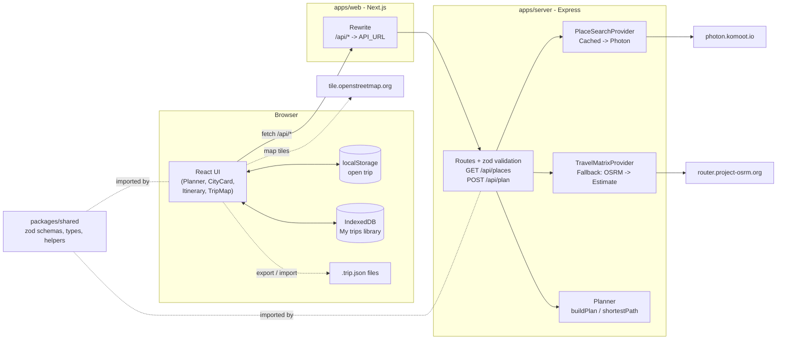
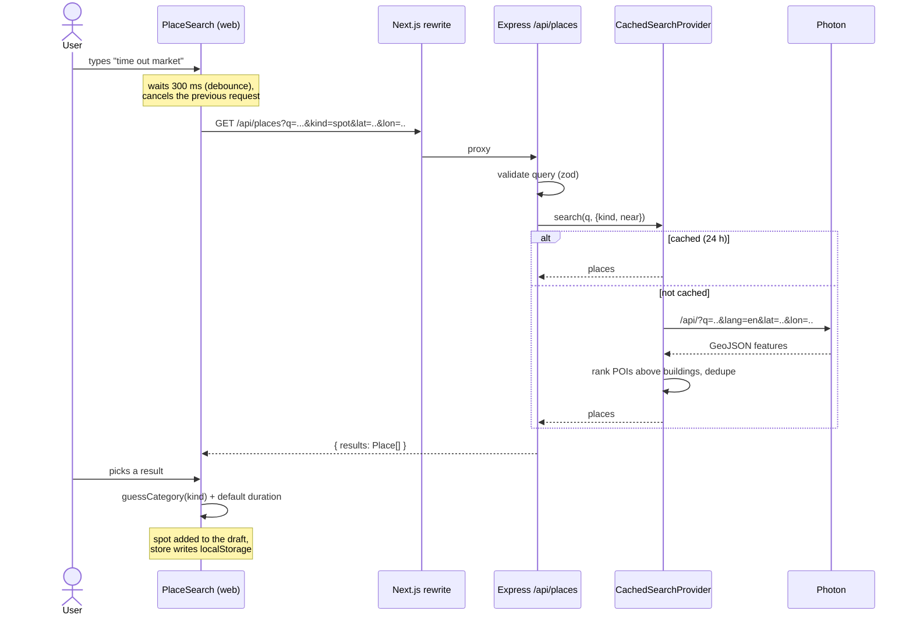
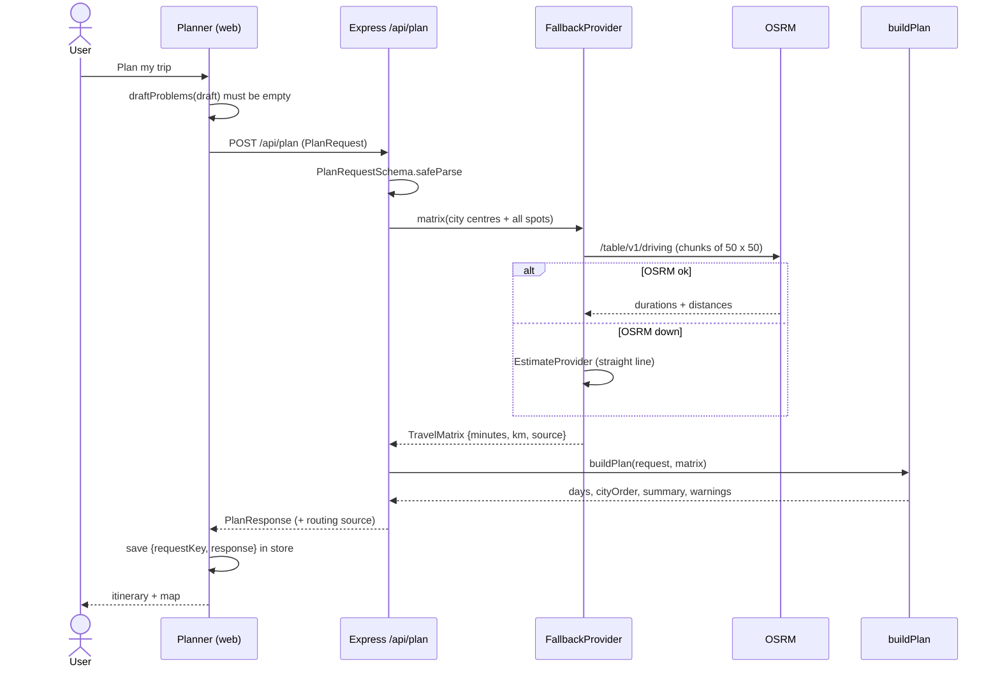
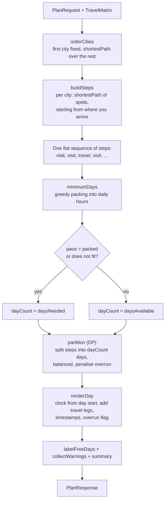
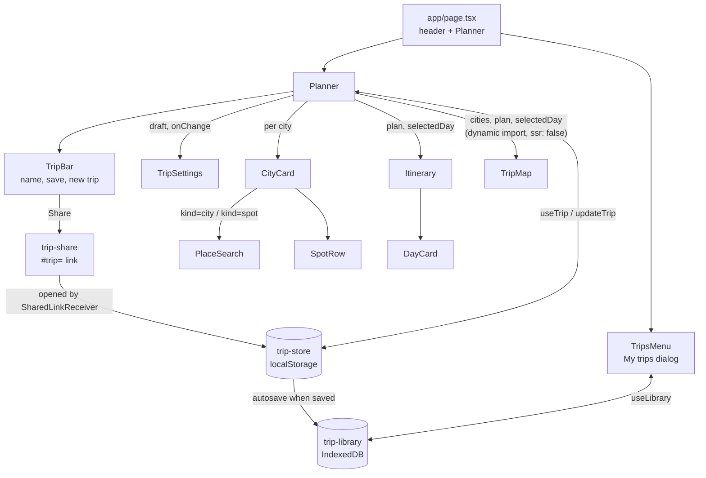
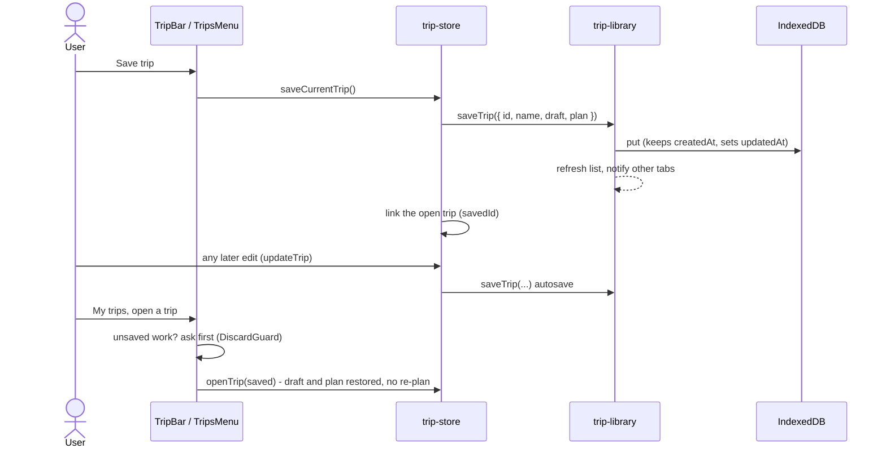
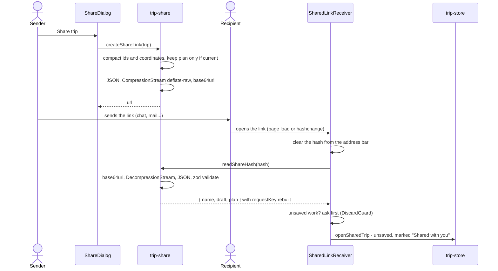

# Trip Planner

Give it your travel dates, the cities you are visiting and the spots you want to see in
each one (cafes, parks, adventure parks, restaurants, museums...). It works out the
quickest order to visit them and splits everything into a day-by-day itinerary with
start times, travel legs and a map.

This README is the handbook for the project: how to run it, how it is put together, how
a request flows through the code, how the planning algorithm works, and why things are
built the way they are.

## Contents

- [Quick start](#quick-start)
- [Using the app](#using-the-app)
- [Architecture](#architecture)
- [Repository layout](#repository-layout)
- [Code flow](#code-flow)
- [The planning algorithm](#the-planning-algorithm)
- [API reference](#api-reference)
- [Frontend](#frontend)
- [Configuration](#configuration)
- [Testing](#testing)
- [Key decisions](#key-decisions)
- [Limitations and next steps](#limitations-and-next-steps)

## Quick start

Requires Node.js 22+.

```bash
npm install
npm run dev        # web on http://localhost:3000, API on http://localhost:4000
```

No API keys are needed. Place search uses [Photon](https://photon.komoot.io) and travel
times come from the public [OSRM](https://project-osrm.org) server, both built on
OpenStreetMap data.

| Command                                      | What it does                                  |
| -------------------------------------------- | --------------------------------------------- |
| `npm run dev`                                | Runs API and web together with live reload    |
| `npm test`                                   | Unit and API tests (Vitest)                   |
| `npm run e2e -w web`                         | End-to-end browser tests (Playwright)         |
| `npm run lint` / `npm run typecheck`         | ESLint and TypeScript across all workspaces   |
| `npm run build`                              | Production builds of server and web           |
| `npm run start -w server` / `-w web`         | Run the production builds                     |

## Using the app

1. **Trip settings** - pick start and end dates (both days count) and your daily hours,
   e.g. 09:00 to 20:00. Nothing gets scheduled outside these hours unless it cannot fit.
2. **Pace** - *Relaxed* spreads the spots over every day of the trip. *Packed* uses as few
   days as possible and leaves the rest free.
3. **City order** - *Optimize* keeps city 1 as your starting point (where you land) and
   picks the quickest order for the rest. *Keep my order* visits cities as listed; the
   arrow buttons on each city card reorder them.
4. **Cities and spots** - search a city, then search spots inside it. Spot results are
   biased towards that city. Each spot gets a category and visit duration guessed from
   its OpenStreetMap type (a cafe gets 1 h, a theme park 4 h); change them if you like.
5. **Plan my trip** - the itinerary shows each day with timed visits and travel legs. Click
   a day to zoom the map to it. If the spots do not fit in your dates, the extra days
   needed are added at the end, marked *Extra day*, with a warning.

6. **Save trip** - give the trip a name (or keep the suggested one, e.g. *Lisbon & Porto,
   Nov 2026*) and save it to **My trips**. From then on every change, including new
   plans, saves automatically.
7. **My trips** - the header button lists your saved trips. Open one to pick up where you
   left off, with its plan and map, without planning again. You can also delete trips,
   export one as a `.trip.json` file, or import files (for a backup, another browser, or a
   friend). Imports never overwrite: a clashing name gets a suffix such as *(2)*.
8. **Share** - the share button next to the trip name makes a link that contains the
   whole trip. Whoever opens it sees the same trip and day-by-day plan straight away, with
   no account and nothing uploaded, and can save their own copy.

The trip you are working on survives a refresh even if you never save it. *New trip* and
opening another trip ask first if that would throw away an unsaved trip. If you edit the
trip after planning, the plan is greyed out and marked stale until you re-plan.

## Architecture



There are three pieces:

| Piece             | Role                                                                                                     |
| ----------------- | -------------------------------------------------------------------------------------------------------- |
| `apps/web`        | Next.js UI. Everything interactive is a client component. The Next server only serves the page and proxies `/api/*` to the API. |
| `apps/server`     | Express API. Talks to the external map services and runs the planner. The planner is pure functions with no I/O. |
| `packages/shared` | The contract between the two: zod schemas for requests, TypeScript types for responses, and small helpers (dates, times, categories). |

External services are behind two small interfaces, so they can be swapped (for example for
Google Maps) without touching the planner or the UI:

```ts
interface PlaceSearchProvider  { search(query, { kind, near, limit }): Promise<Place[]> }
interface TravelMatrixProvider { matrix(points: LatLon[]): Promise<TravelMatrix> }
```

## Repository layout

```
apps/
  server/
    src/
      index.ts              wires providers from env vars and starts the server
      app.ts                Express routes, validation, error handling (createApp(deps))
      places/photon.ts      Photon search, result ranking, in-memory cache
      routing/types.ts      TravelMatrix and provider interface
      routing/osrm.ts       OSRM table client (chunked) + FallbackProvider
      routing/estimate.ts   straight-line distance estimates
      planner/route.ts      shortestPath: Held-Karp / nearest-neighbour + 2-opt
      planner/schedule.ts   buildPlan: city order, steps, day split, timeline
    test/                   Vitest unit + API tests
  web/
    src/
      app/                  layout, page, global styles
      components/           Planner, TripSettings, CityCard, PlaceSearch,
                            Itinerary, TripMap, CategoryIcon,
                            TripBar, TripsMenu, Modal, DiscardGuard,
                            ShareDialog, SharedLinkReceiver
      lib/api.ts            typed fetch client
      lib/trip.ts           trip draft model and schemas, validation, request builder
      lib/trip-store.ts     the open trip: localStorage store (useSyncExternalStore)
      lib/trip-library.ts   saved trips: IndexedDB store, cross-tab sync
      lib/trip-file.ts      .trip.json export and import
      lib/trip-share.ts     share links: encode a trip into the URL fragment and back
      lib/format.ts         date/time/distance formatting, day colours
    e2e/                    Playwright tests
packages/
  shared/src/index.ts       schemas, types, categories, helpers
```

## Code flow

### Searching and adding a spot



### Planning a trip



### Inside `buildPlan`



## The planning algorithm

The code is in `apps/server/src/planner`. It is deterministic and has no I/O, so it is
fully unit tested.

### Inputs

- The request: dates, daily hours, pace, city order mode, cities with spots
  (each spot has coordinates, a category and a visit duration).
- A travel matrix covering every city centre and every spot: driving minutes and
  kilometres for each ordered pair. Every move between two different places gets an extra
  `TRANSFER_BUFFER_MINUTES = 10` for parking, walking and waiting.

### Step 1 - order the cities

With *Optimize*, city 1 stays first and the remaining cities are ordered by
`shortestPath` using city-centre travel times. With *Keep my order*, or with 2 or fewer
cities, the given order is used.

### Step 2 - order the spots in each city

For each city, `shortestPath` finds the order of its spots that minimises travel,
**starting from the last spot of the previous city** (so you begin next to where you
arrive). For the first city the start is free.

`shortestPath` solves an *open* travelling-salesman path (no return to the start):

| Spots in a city | Method                                                          | Quality               |
| --------------- | --------------------------------------------------------------- | --------------------- |
| up to 12        | Held-Karp dynamic programming, O(2^n * n^2)                     | optimal               |
| more than 12    | nearest neighbour from up to 8 start points, then 2-opt         | near-optimal, fast    |

The 2-opt step accumulates forward and reversed segment costs as it scans, so each
candidate swap costs O(1) even though OSRM times are asymmetric (A to B can differ from B
to A). 150 spots plan in well under a second.

### Step 3 - one sequence of steps

The ordered cities and spots become one flat list of **steps**:

```
visit Oceanario -> visit Time Out Market -> visit Belem Tower -> travel to Porto -> visit Cafe Majestic -> visit Livraria Lello
```

Each visit knows its duration and the travel time from the previous spot (its *lead*).
Moves between cities are separate `travel` steps. Keeping everything in one sequence
means a day can hold the end of one city and the start of the next, and a long drive can
take a day of its own.

### Step 4 - split the sequence into days

The **load** of a day is the visit time plus the travel between its consecutive steps.
The travel *into* a day's first spot is dropped, because the day starts there (we do not
know where you sleep yet). Prefix sums make the load of any range O(1).

- `minimumDays` packs steps greedily until the next one would pass the daily hours. For
  contiguous packing, greedy gives the fewest days.
- `partition` splits the steps into exactly `dayCount` contiguous (possibly empty) days
  with dynamic programming, minimising

  ```
  sum over days of  load^2 + 10,000 * max(0, load - dayLength)^2
  ```

  Squaring the load favours evenly balanced days over one heavy and one light day. The
  overrun term makes running past the day end far more expensive than anything else, so
  it only happens when one spot alone is longer than the day. The DP is
  O(dayCount * steps^2), which is trivial at the 60 day / 150 spot limits.

`dayCount` is the trip length for *Relaxed*, and the minimum for *Packed*. If even the
minimum is more than the trip length, the extra days are kept and marked `overBudget`.

### Step 5 - timeline and warnings

`renderDay` starts a clock at the day start and walks the steps, inserting travel items
between visits, which produces start and end times (minutes since midnight). Days with no
visits are labelled with the city you are in (shown as *Free day* or *Travel day*).
Warnings explain when the trip is too short, when a single spot or drive is longer than
the daily hours, and when days run late.

### Worked example

Lisbon (Belem Tower 1 h 30, Time Out Market 1 h 30, Oceanario 4 h) and Porto (Cafe
Majestic 1 h, Livraria Lello 2 h), 4 days, 09:00 to 20:00, real OSRM times:

| Day | Relaxed                                                    | Packed                                                                  |
| --- | ---------------------------------------------------------- | ----------------------------------------------------------------------- |
| 1   | Oceanario 09:00-13:00                                      | Oceanario 09:00-13:00, drive 23 min, Time Out Market 13:23-14:53        |
| 2   | Time Out Market 09:00-10:30, drive 20 min, Belem Tower 10:50-12:20 | Belem Tower 09:00-10:30, drive to Porto 3 h 42 (320 km), Cafe Majestic 14:12-15:12, drive 16 min, Livraria Lello 15:28-17:28 |
| 3   | Drive to Porto, 3 h 42 (320 km)                            | Free day                                                                |
| 4   | Cafe Majestic 09:00-10:00, drive 16 min, Livraria Lello 10:16-12:16 | Free day                                                        |

Both use the same route: the shortest path through Lisbon, then the drive, then Porto. *Relaxed* spreads the 2 days of activity over all 4 days, with the long
drive on a day of its own. *Packed* fits everything into the minimum of 2 days. Note
the travel into each day's first spot is not shown, since the day starts there.

## API reference

All responses are JSON. Errors are `{ "error": string, "details"?: string[] }`.

### `GET /api/places`

| Query param | Required | Description                                       |
| ----------- | -------- | ------------------------------------------------- |
| `q`         | yes      | Search text, 2 to 200 characters                  |
| `kind`      | no       | `city` (cities, regions) or `spot` (default)      |
| `lat`,`lon` | no       | Bias results towards this point                   |

Returns `{ "results": Place[] }` where
`Place = { name, label, lat, lon, kind? }` and `kind` is the raw OSM type (e.g. `cafe`).
Responds `400` for invalid input and `502` if Photon is unavailable.

### `POST /api/plan`

```jsonc
{
  "startDate": "2026-11-01",      // YYYY-MM-DD, trip is inclusive, at most 60 days
  "endDate": "2026-11-04",
  "dayStart": "09:00",            // HH:MM, at least an hour before dayEnd
  "dayEnd": "20:00",
  "cityOrder": "optimize",        // or "keep"
  "pace": "relaxed",              // or "packed"
  "cities": [
    {
      "id": "c1",
      "place": { "name": "Lisbon", "label": "Portugal", "lat": 38.71, "lon": -9.14 },
      "spots": [
        {
          "id": "s1",
          "place": { "name": "Belem Tower", "label": "Lisbon", "lat": 38.69, "lon": -9.22 },
          "category": "attraction",
          "durationMinutes": 90     // 10 to 960
        }
      ]
    }
  ]
}
```

Response:

```jsonc
{
  "days": [
    {
      "date": "2026-11-01",
      "cityIds": ["c1"],             // cities touched that day, in order
      "items": [
        { "kind": "visit", "spotId": "s1", "cityId": "c1", "name": "Belem Tower",
          "category": "attraction", "start": 540, "end": 630 },      // minutes since midnight
        { "kind": "travel", "fromName": "Belem Tower", "toName": "Time Out Market",
          "intercity": false, "start": 630, "end": 650, "distanceKm": 7.2 }
      ],
      "overBudget": false,           // after the requested end date
      "overrun": false               // runs past dayEnd
    }
  ],
  "cityOrder": ["c1", "c2"],
  "summary": { "daysAvailable": 4, "daysNeeded": 2, "fits": true,
               "visitMinutes": 600, "travelMinutes": 258, "travelKm": 329 },
  "warnings": [],
  "routing": "osrm"                  // or "estimate" if OSRM was unavailable
}
```

## Frontend



- **State** - `lib/trip-store.ts` keeps the open trip in a module-level store that
  writes through to localStorage, read with `useSyncExternalStore`. The server render
  gets `null` and shows a loading shell, and the browser fills in the saved trip during
  hydration. This avoids hydration mismatches and needs no state library.
- **Stale plans** - a saved plan stores the exact request JSON that produced it
  (`requestKey`). If the current draft would produce a different request, the plan is
  shown greyed out with a re-plan prompt, and the map shows the draft instead.
- **Place search** - `PlaceSearch` is an ARIA combobox (arrow keys, Enter, Escape) that
  debounces input by 300 ms and aborts in-flight requests when you keep typing.
- **Map** - `TripMap` uses Leaflet with OpenStreetMap tiles and is loaded only in the
  browser. Pins are numbered per day and coloured by day, solid lines connect a day's
  visits, dashed lines show intercity travel on the day it happens. Selecting a day dims
  the others and zooms to that day, including its drive.
- **Validation** - `draftProblems` gives friendly messages (missing city, empty city,
  bad dates) and disables the Plan button. The server validates again with the shared
  zod schema.

### Saved trips

Two stores with different jobs:

| Store                      | Holds                                      | Why there                                                                 |
| -------------------------- | ------------------------------------------ | ------------------------------------------------------------------------- |
| `trip-store` (localStorage) | The open trip: `{ draft, plan, savedId, name }` | Synchronous, so the trip is ready on the first client render; one small record |
| `trip-library` (IndexedDB) | Every saved trip with its last plan        | Asynchronous, much larger quota than localStorage, fine for many trips with plans |



- **Linking** - `savedId` ties the open trip to a library entry. While linked, every
  `updateTrip` also writes to IndexedDB, so there is no separate "save changes" step.
  Opening a trip or starting a new one replaces the open trip without writing anything.
- **Validation** - everything read back (localStorage, IndexedDB rows, imported files) is
  parsed with zod schemas (`TripDraftSchema`, `SavedPlanSchema`, `PlanResponseSchema`).
  Bad rows are skipped, so one corrupt entry cannot break the app. The open-trip schema
  has defaults, so trips stored before saved trips existed still load.
- **Tabs** - a `BroadcastChannel` tells other open tabs to reload the list after a change.
  If the same trip is edited in two tabs at once, the last write wins.
- **Durability** - the first save calls `navigator.storage.persist()`, asking the browser
  not to evict saved trips when disk space is low. If storage is blocked (some private
  modes), saving is disabled with an explanation and the rest of the app still works.
- **File format** - `{ format: "travel-planner-trip", version: 1, name, draft, plan }`.
  The version field leaves room for migrations. Imports always get a new id.

### Share links

A share link carries the whole trip in the URL fragment:

```
https://host/#trip=1.<base64url(deflate-raw(JSON { name, draft, plan }))>
```



- **Nothing leaves the browser** - browsers never send the fragment (`#...`) to a
  server, so neither our servers nor their logs ever see the trip. The link is the trip.
- **Size** - random ids are replaced with short ones (`c1`, `s2`) and coordinates are
  rounded to 5 decimals (about a metre) before compressing. A 2-city, 5-spot trip with
  its plan is about 1 KB; 30 spots about 2.2 KB. Over 8,000 characters the dialog warns
  that some apps cut long links and suggests exporting a file instead.
- **Plan only if current** - the plan is included only when it matches the trip as it is
  (`isPlanCurrent`), so a recipient never sees a stale plan. The recipient rebuilds the
  `requestKey` from the decoded draft, so the plan shows as current without re-planning.
- **Opening** - the receiver runs on load and on `hashchange` (a link pasted into an open
  tab). It clears the hash first, so a refresh does not reopen the link over edits. The
  shared trip opens unsaved; the usual unsaved-work prompt protects the recipient's own
  trip. Broken or cut-off links show a clear message at the top of the sidebar.
- **Versioned** - the `1.` prefix is the format version. Decoding validates with the same
  zod schemas as storage, so a tampered link can only fail with a message.

## Configuration

| Env var      | App    | Default                           | Purpose                       |
| ------------ | ------ | --------------------------------- | ----------------------------- |
| `PORT`       | server | `4000`                            | API port                      |
| `OSRM_URL`   | server | `https://router.project-osrm.org` | Routing server (self-hostable) |
| `PHOTON_URL` | server | `https://photon.komoot.io`        | Geocoder (self-hostable)      |
| `API_URL`    | web    | `http://localhost:4000`           | Where `/api/*` is proxied     |

Timeouts: 8 s for place search, 15 s for routing. Limits: 60 trip days, 150 spots.

## Testing

| Layer            | Tool       | Where                        | What it covers                                                        |
| ---------------- | ---------- | ---------------------------- | --------------------------------------------------------------------- |
| Algorithm        | Vitest     | `server/test/route.test.ts`, `schedule.test.ts` | Optimality against brute force, 150-spot performance, ordering, balancing, packing, overflow, travel days, timelines |
| Providers        | Vitest     | `server/test/osrm.test.ts`   | OSRM chunking under 100 coordinates, unroutable pairs, fallback       |
| HTTP API         | Supertest  | `server/test/app.test.ts`    | Validation, error codes, malformed JSON, happy path                   |
| End to end       | Playwright | `web/e2e/trip.spec.ts`       | Full user flow on desktop and mobile against the real API and a production build |
| End to end       | Playwright | `web/e2e/saved-trips.spec.ts` | Save, reopen with plan, autosave, delete, unsaved-work prompt, export and import |
| End to end       | Playwright | `web/e2e/share.spec.ts`      | Share link opens the same plan in a fresh browser, stale plans left out, cut-off links, unsaved-work prompt |

The planner tests use a flat-world matrix (1 km = 1 minute) from `test/fixtures.ts`, so
expected times can be worked out by hand. The E2E tests stub place search in the browser
and point OSRM at a closed port, so they never depend on public services and are not
flaky.

## Key decisions

| # | Decision | Why | Trade-off |
| - | -------- | --- | --------- |
| 1 | **OpenStreetMap services (Photon + OSRM) instead of Google Maps** | No API key, billing or setup; works the moment you clone it. Real road travel times, not guesses. | No public transport or walking times, no opening hours, place data less complete. Swappable via the provider interfaces. |
| 2 | **Providers behind small interfaces** (`PlaceSearchProvider`, `TravelMatrixProvider`) | The planner and UI do not know where data comes from, so Google Maps, a self-hosted OSRM or a fake for tests plug in without other changes. | One extra layer of indirection. |
| 3 | **Graceful degradation to distance estimates** | A trip plan with estimated times is more useful than an error page when OSRM is down. Unroutable pairs (across a sea) get an estimate for just that pair. | Estimates can be off; the UI clearly labels them. |
| 4 | **Users pick places from search results** rather than typing free text | Ambiguous names ("Paris", "Majestic Cafe") are resolved by the user once, so plans use the right coordinates and planning needs no geocoding. | One extra click per spot. |
| 5 | **Planner as pure functions on a precomputed matrix** | Deterministic, fast, easy to test exhaustively; all network I/O happens once up front. | One OSRM call covers all pairs, which grows quadratically (chunked, fine at 150 spots). |
| 6 | **Exact TSP for small cities, heuristic for large** | Most cities have a handful of spots, where Held-Karp is instant and optimal; large lists still plan in under a second. | Large lists are near-optimal, not guaranteed optimal. |
| 7 | **Order cities first, then spots, then split into days** (hierarchical) | Matches how people travel (you do not zig-zag between cities), keeps each sub-problem small and explainable. | Not a global optimum over every possible itinerary. |
| 8 | **One flat step sequence split by DP** instead of fixed days per city | Lets a day mix the end of one city and the start of the next, and gives long drives their own day, while still being optimal for the chosen order. | Days are contiguous slices of the route; it never reorders spots to balance days. |
| 9 | **Sum of squared loads + heavy overrun penalty** as the day objective | Squares produce evenly balanced days; the penalty means days only run late when one spot is longer than the day. | Relaxed mode may give a long drive its own day rather than combining it with a visit. |
| 10 | **Relaxed vs Packed pace** | "Efficient" means different things: spreading out over the trip, or finishing as fast as possible. Both use the same algorithm with a different day count. | One more setting to explain. |
| 11 | **First city stays fixed when optimizing** | City 1 is usually where you land; reordering it would produce plans you cannot follow. | You cannot ask it to choose a starting city. |
| 12 | **10 minute buffer on every move** | Real transfers include parking, finding the entrance and waiting; raw driving times make plans too tight. | Slightly conservative for spots next door to each other. |
| 13 | **Category-based default durations, editable** | Gives a sensible plan with zero effort, using OSM types to guess the category. | Defaults are rough averages. |
| 14 | **Shared zod schemas in `packages/shared`** | One source of truth for the contract; the server validates with it and both sides share the inferred types. | Both apps depend on the shared package (bundled via tsup and Next.js). |
| 15 | **Next.js only for UI; Express for the API** | Keeps the backend a plain, independently runnable Node + TypeScript service as requested; Next rewrites `/api` so there is no CORS. | Two processes in development (`npm run dev` runs both). |
| 16 | **No database; trips stay in the browser** | A personal planner does not need accounts. Refresh-safe with zero infrastructure. | Trips do not sync across devices or browsers (export/import covers moving them). |
| 17 | **`useSyncExternalStore` store instead of a state library** | Tiny, hydration-safe, no dependencies. | Hand-written store (about 50 lines). |
| 18 | **Photon searches in English and re-ranks results** | Without `lang=en` "Lisbon" only matches towns in the US; cities prefer settlements over admin areas, spots prefer POIs over building footprints so categories are right. | English-only names in results. |
| 19 | **In-memory search cache (24 h)** | Debounced typing repeats queries; caching keeps the UI fast and is polite to the free Photon service. | Cache resets on restart; not shared across instances. |
| 20 | **Deterministic E2E tests** | Public map services are slow and change over time; stubbing them keeps the suite fast and not flaky while still exercising the real API and UI. | Live Photon/OSRM integration is checked manually, not in CI. |
| 21 | **Saved trips in IndexedDB, not the File System Access API** | IndexedDB works in every browser, is fast and asynchronous, and has room for many trips with plans. The File System Access API only exists in Chromium browsers and needs a file picker for every save, which does not fit a "My trips" list. | Trips live inside the browser profile; clearing site data removes them (export guards against that). |
| 22 | **Export / import as plain `.trip.json` files** | Works in every browser with a normal download and file input, gives backups and sharing, and the files are readable and versioned. | Manual: there is no automatic sync. |
| 23 | **Autosave once a trip is saved** | Nothing to forget and no "unsaved changes" state for saved trips; matches how documents work in modern apps. | Experimenting changes the saved trip; save a copy by exporting and importing it. |
| 24 | **Open trip in localStorage, library in IndexedDB** | The open trip must be readable synchronously for a flicker-free first render; the library can load asynchronously and needs the larger quota. | Two stores to keep in step (only through `trip-store`). |
| 25 | **Schema-validate everything read from storage or files** | Stored data outlives code versions and files can come from anywhere; validation turns bad data into a skipped row or a clear message instead of a crash. | Response schemas now live in `packages/shared` next to the types they define. |
| 26 | **Share links carry the trip in the URL fragment** instead of storing it on a server | No backend, no database, no expiry, and private by construction: the fragment is never sent to any server. Works offline and in every modern browser. | Links grow with the trip (about 1 KB for a small trip), a link is a snapshot that does not update, and anyone holding it can read the trip. |
| 27 | **deflate-raw via `CompressionStream` and base64url** | Built into browsers, so no compression library; JSON of a trip compresses well. base64url needs no escaping in URLs. | Asynchronous API; browsers older than 2023 cannot create or open links. |
| 28 | **Plan included only if current; ids compacted** | The recipient sees exactly what the sender sees, never a stale plan. Short ids and rounded coordinates cut the link size substantially. | A stale trip is shared without its plan, so the recipient plans it themselves. |

## Limitations and next steps

- **Meal times** - restaurants are scheduled wherever the route puts them, which can mean
  lunch at 10:45. Next: time windows per category (lunch 12:00 to 14:30, dinner 19:00 to
  21:30) handled in the scheduler.
- **Where you stay** - each day starts at its first spot. Next: an optional hotel per city
  so days start and end there.
- **Opening hours** - not considered. OSM `opening_hours` is patchy; Google Places would
  improve it.
- **Travel modes** - driving only. Walking is available from OSRM foot profiles; public
  transport needs a provider like Google or Transitous.
- **Flights** - long intercity hops are treated as drives (or estimates across seas).
- **Live sharing** - a share link is a snapshot; later edits are not seen by the
  recipient. Next: collaborative trips would need a sync backend.
- **Trip sync** - saved trips stay in one browser. Next: optional accounts or a sync
  backend so trips follow you across devices, and "Duplicate" to branch a trip.
- **Must-do vs nice-to-have** - when spots do not fit, all are still scheduled on extra
  days. Priorities would let the planner drop the least important ones instead.
